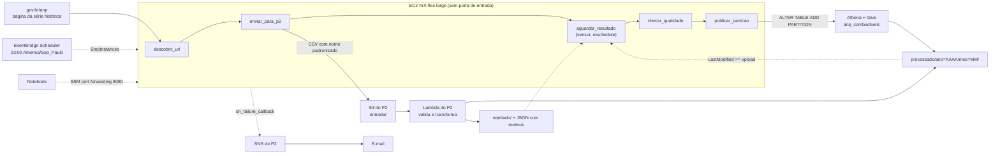
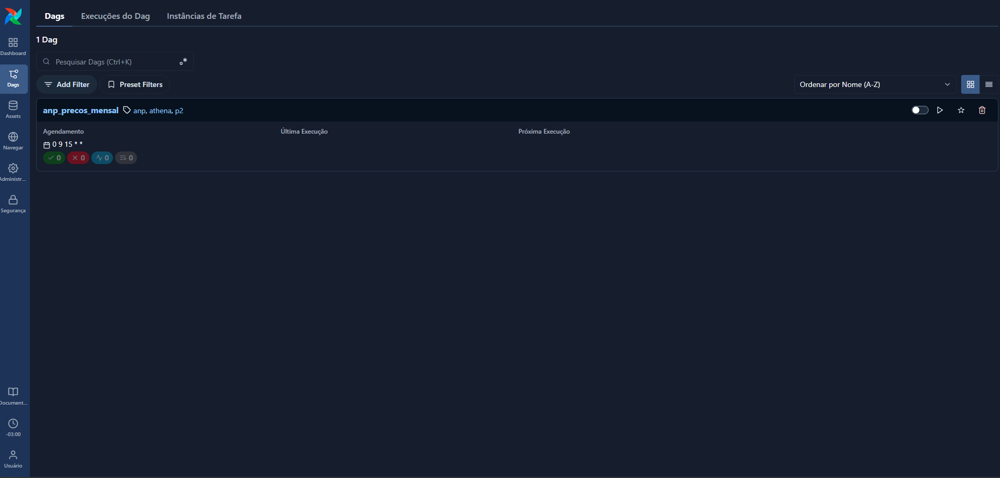
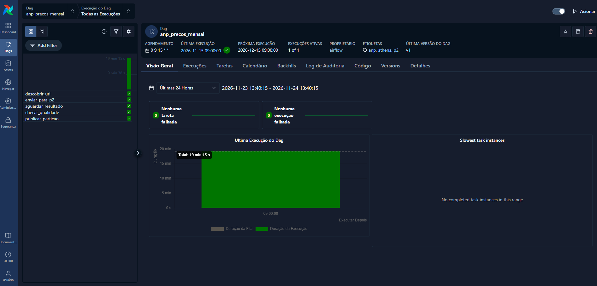
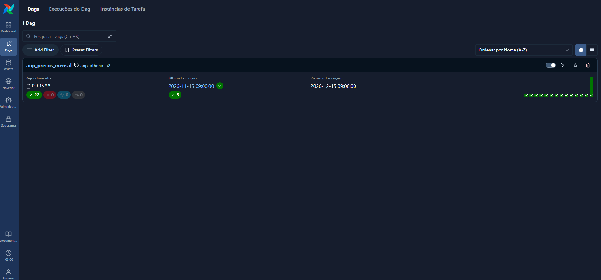
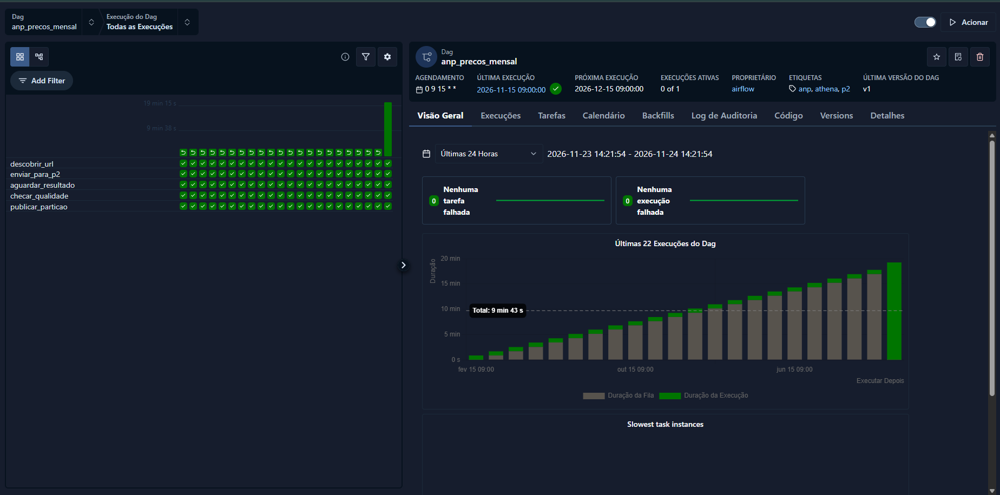
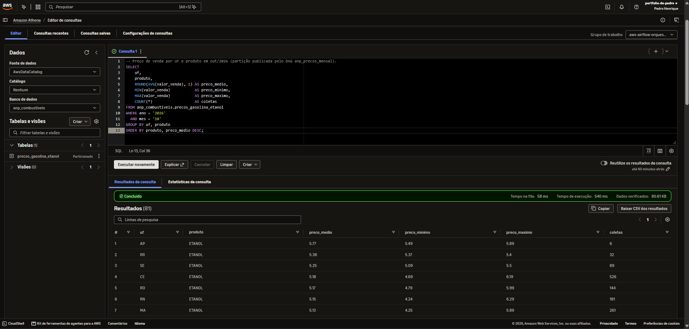
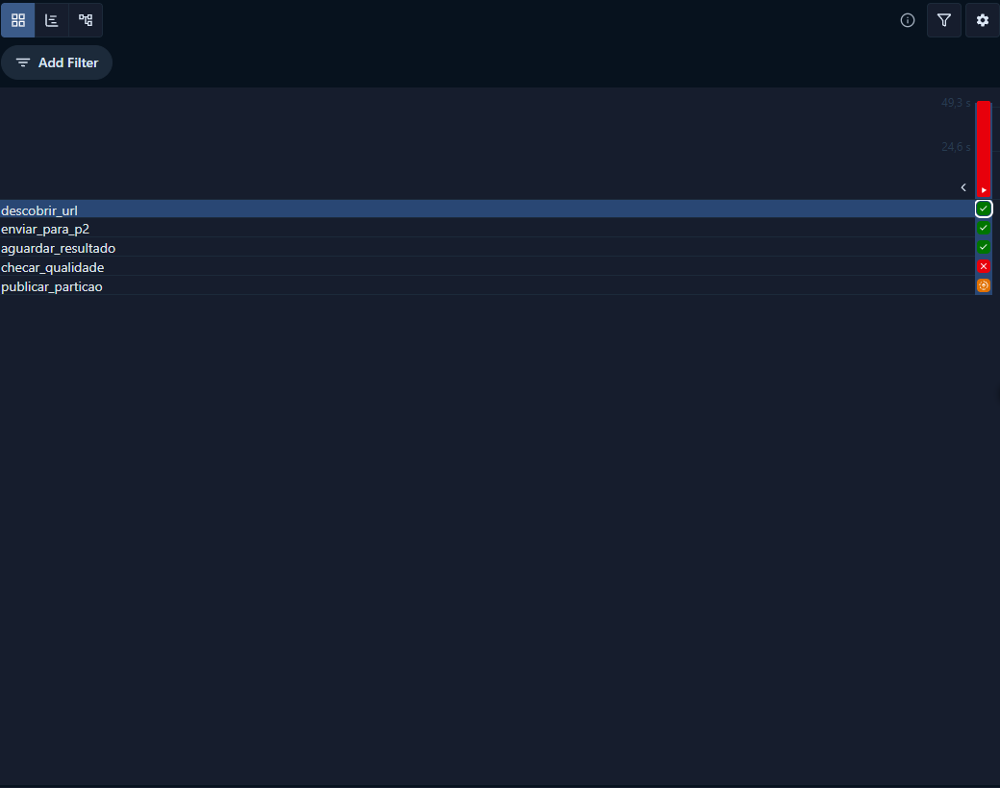
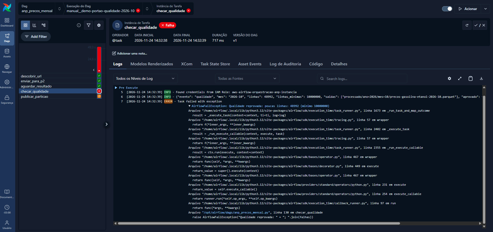
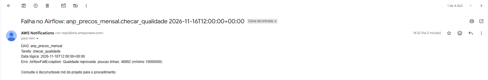

# Orquestração com Airflow na AWS: preços de combustíveis da ANP

[](https://github.com/pedrosilva8140/aws-airflow-orquestracao-anp/actions/workflows/ci.yml)

Um DAG mensal no Apache Airflow descobre o arquivo de preços de gasolina e etanol da ANP, entrega ao [pipeline orientado a eventos do P2](https://github.com/pedrosilva8140/aws-pipeline-eventos-anp), espera o resultado, aplica portões de qualidade e só então publica a partição no Glue para consulta no Athena. O histórico foi carregado com um backfill explícito. O Airflow roda em Docker Compose numa EC2 sem nenhuma porta aberta, acessada só pelo SSM, e desliga sozinho às 23:00.

**Stack:** Apache Airflow 3.4 · Python 3.12 · Docker Compose · PostgreSQL 16 · AWS EC2 · SSM · EventBridge Scheduler · Glue · Athena · S3 · SNS · IAM · Terraform · GitHub Actions · pytest · ruff

**Destaques**
- **22 meses publicados (jan/2025 a out/2026), 1.047.874 linhas.** O backfill de 21 meses levou 17 min 47 s, um mês por vez, todos na 1ª tentativa.
- **Portão de qualidade que bloqueia de verdade:** um mês reprovado falha sem retentativa, a partição não é publicada e chega um e-mail de alerta.
- **Recuperação automática na 1ª execução:** a primeira execução real falhou com 403 por falta de uma permissão de IAM. Corrigi só a política (1 recurso alterado, nenhuma linha de código), e a retentativa automática do Airflow concluiu sozinha, sem intervenção na tarefa.
- **Custo real abaixo de US$ 0,50 no projeto:** a EC2 ficou ligada 2,5 h no total (US$ 0,24 a US$ 0,09576/h, mais US$ 0,01 de IP público), com o disco de 30 GB a US$ 0,08 por dia até o destroy. As horas vêm do CloudTrail (`RunInstances`, `StartInstances` e `StopInstances`).
- **Acesso sem porta aberta:** security group sem regra de entrada, interface só em `127.0.0.1` e port forwarding pelo SSM.
- **64 testes e CI com três jobs:** Python (lint e testes, com os testes de integridade do DAG obrigatórios), Docker Compose (validação e build da imagem) e Terraform (fmt e validate).

> A infraestrutura foi destruída depois dos testes. Os prints abaixo são a evidência da execução.

## Arquitetura



O P4 não processa dados: ele orquestra o P2. O P2 reage a arquivos em `entrada/`; o P4 decide **quando** enviar, **espera** o resultado, **verifica** a qualidade e só então **publica**. O bucket, o tópico de alertas e a Lambda são do P2. O P4 cria a EC2, as roles, o catálogo (Glue), o workgroup do Athena, o parâmetro da senha e o agendamento de desligamento.

## O DAG `anp_precos_mensal`



Roda no dia 15 de cada mês, às 09:00 (America/Sao_Paulo), e processa o **mês anterior** (a ANP publica no início do mês seguinte).

| Tarefa | O que faz | Cuidado |
|---|---|---|
| `descobrir_url` | Lê a página da ANP e encontra o link do mês | Os nomes da ANP são inconsistentes (erro de digitação "cados", arquivo sem extensão, mês no início ou no fim). A URL nunca é montada por padrão: é encontrada pelo ano no caminho e pelo mês no nome. Mês ausente: erro comum, as retentativas tentam mais tarde. Dois links para o mesmo mês: falha sem retentativa, nunca escolhe um arbitrariamente. |
| `enviar_para_p2` | Baixa em streaming, confere o básico e envia para `entrada/precos-gasolina-etanol-AAAA-MM.csv` | Barra HTML de erro e arquivo vazio antes do upload. O nome padronizado torna o reprocessamento idempotente. Guarda o `LastModified` do upload. |
| `aguardar_resultado` | Sensor em `mode="reschedule"` (poke a cada 30 s, timeout de 15 min) | Só aceita saídas com `LastModified` igual ou posterior ao upload, para um Parquet antigo de outra execução não ser aceito. Rejeição pelo P2: falha sem retentativa com os motivos do JSON. Saída só em outra partição: confirma de novo antes de falhar. |
| `checar_qualidade` | Lê o Parquet e roda os portões | Qualquer falha bloqueia a publicação, sem retentativa. |
| `publicar_particao` | `ALTER TABLE ... ADD IF NOT EXISTS PARTITION` no Athena | Idempotente. Para a consulta se passar do timeout. |

Todas as tarefas têm 3 retentativas com atraso exponencial (5, 10 e 20 min), `execution_timeout` de 10 min e alerta por e-mail em caso de falha. `catchup=False` e `max_active_runs=1`: o histórico entra por backfill explícito, um mês por vez.

## Decisões de projeto

- **EC2 com Docker Compose em vez de MWAA.** O MWAA tem custo fixo contínuo, inviável num projeto de portfólio. A EC2 só fica ligada nas sessões de trabalho e é desligada pelo EventBridge Scheduler às 23:00.
- **LocalExecutor e Postgres, sem Celery, Redis nem triggerer.** Para um DAG mensal, um executor local basta. O sensor usa `reschedule`, que libera o slot entre os pokes sem precisar de triggerer. Em repouso, os quatro serviços usam cerca de 800 MiB dos 8 GB.
- **A lógica fica fora do Airflow.** O pacote `dags/anp/` não importa `airflow`: são funções puras testadas no Windows com um S3 falso. O arquivo do DAG só encadeia essas funções. Os testes de integridade do DAG rodam no CI (Linux), e lá a ausência do Airflow é erro, não teste pulado.
- **Só conta o que é mais novo que o upload.** Num reprocessamento, o Parquet da execução anterior já existe. O sensor compara o `LastModified` com o instante do upload, então nunca aceita saída antiga.
- **Acesso sem porta aberta.** Nada de SSH nem de IP liberado: a sessão é pelo SSM, e a interface fica só em `127.0.0.1:8080` na instância.
- **Segredos fora do tfstate.** Só a senha do admin passa pelo Terraform (SSM SecureString com a chave gerenciada pela AWS). A senha do Postgres, a chave Fernet e o segredo JWT são gerados na própria instância.
- **Versões fixadas pelas constraints oficiais do Airflow.** O CI e a imagem usam o mesmo arquivo de constraints do Airflow 3.4.0 para Python 3.12.

## Portões de qualidade

| Portão | Regra | Out/2026 (dado real) |
|---|---|---|
| Linhas | pelo menos 10.000 (ajustável por `params`) | 48.992 |
| Preço | `valor_venda` entre R$ 2,00 e R$ 15,00 | 3,09 a 9,92 |
| Datas | toda `data_coleta` dentro do mês | 01/10 a 30/10 |
| UFs | as 27 presentes | 27 |
| Produtos | GASOLINA e ETANOL presentes | 3 produtos |
| Vazamento | nenhuma saída do arquivo fora da partição do mês | nenhuma |

As faixas foram calibradas antes da implantação: gerei o Parquet de out/2026 localmente com o código do P2 e rodei os portões sobre ele. Cada execução registra o resultado num log estruturado (JSON com linhas, mínimo, saídas, aprovado e falhas).

## Evidências na AWS

### 1. Primeira execução (out/2026)



O Airflow criou a execução agendada sozinho ao ativar o DAG. Ela falhou duas vezes com 403 (ver [problemas](#problemas-encontrados-e-lições)), a política de IAM foi corrigida e a 3ª tentativa automática concluiu as 5 tarefas.

### 2. Backfill de 22 meses





```text
airflow backfill create --dag-id anp_precos_mensal \
  --from-date 2025-02-15 --to-date 2026-10-16 \
  --max-active-runs 1 --reprocess-behavior none
```

| Mês | Linhas | Mês | Linhas |
|---|---|---|---|
| 2025-01 | 46.509 | 2025-12 | 52.336 |
| 2025-02 | 44.290 | 2026-01 | 45.234 |
| 2025-03 | 51.685 | 2026-02 | 44.931 |
| 2025-04 | 49.626 | 2026-03 | 53.388 |
| 2025-05 | 46.910 | 2026-04 | 48.319 |
| 2025-06 | 49.976 | 2026-05 | 45.723 |
| 2025-07 | 45.181 | 2026-06 | 53.454 |
| 2025-08 | 37.623 | 2026-07 | 49.424 |
| 2025-09 | 44.955 | 2026-08 | 51.856 |
| 2025-10 | 43.679 | 2026-09 | 50.717 |
| 2025-11 | 43.066 | 2026-10 | 48.992 |

Os 21 meses do backfill passaram na 1ª tentativa (105 tarefas), em cerca de 51 s por mês. Nenhum mês foi barrado pelos portões. O P2 não rejeitou nenhum arquivo, e a DLQ ficou vazia. A conferência no Athena (`SELECT ano, mes, count(*) ... GROUP BY 1, 2`) devolveu as 22 partições e o mesmo total, lendo 0 bytes (a contagem vem dos metadados do Parquet).

### 3. Consulta de negócio no Athena



Preço médio, mínimo e máximo por UF e produto em out/2026 ([`docs/consultas/preco_medio_uf.sql`](docs/consultas/preco_medio_uf.sql)): 81 linhas (27 UFs × 3 produtos), 82 KB lidos. O workgroup limita cada consulta a 100 MB.

### 4. Portão de qualidade barrando um mês

Execução manual de out/2026 com `conf {"linhas_minimas": 10000000}`, numa data lógica nova (16/11, que também resulta em out/2026), sem tocar na execução que já tinha sucesso.



`checar_qualidade` falhou na 1ª tentativa, sem retentativa, e `publicar_particao` ficou `upstream_failed`. A partição 2026/10 no Glue continuou intacta (mesma data de criação).



### 5. Alerta por e-mail



O `on_failure_callback` publica no tópico SNS do P2. O assunto é curto e só tem ASCII (o SNS exige menos de 100 caracteres, sem quebra de linha); os detalhes vão no corpo.

## Problemas encontrados e lições

### 403 no `HeadObject` e a retentativa que se resolveu sozinha

- **Sintoma:** a primeira execução real falhou em `enviar_para_p2` com 403. O download da ANP e o upload para `entrada/` tinham funcionado.
- **Causa:** logo depois do upload, o código faz um `HeadObject` para ler o `LastModified` usado pelo sensor. Não existe permissão "s3:HeadObject": o `HeadObject` exige `s3:GetObject`, e a role tinha só `s3:PutObject` em `entrada/*`.
- **Por que os testes não pegaram:** os 64 testes passavam porque o S3 falso não modela IAM. A primeira prova real de permissão só acontece na AWS.
- **Correção mínima:** acrescentei `s3:GetObject` em `entrada/*` (a role só lê o que ela mesma grava). Foi 1 recurso alterado no Terraform, sem mudar o código, porque o `HeadObject` protege o sensor contra saídas antigas.
- **Recuperação:** o apply entrou antes da 3ª tentativa, e ela passou sozinha. Não limpei a tarefa.
- **Efeito colateral medido:** o CSV foi enviado 3 vezes (uma por tentativa, porque o 403 vinha depois do upload), e a Lambda do P2 rodou 3 vezes. As três sobrescreveram o mesmo Parquet. Como o sensor só aceita saídas posteriores ao upload, só a saída da 3ª tentativa valeu.

### Nome reservado no SSM e um apply parcial

- **Sintoma:** o primeiro `terraform apply` do P4 criou 9 dos 14 recursos e parou com `AccessDeniedException: No access to reserved parameter name`.
- **Causa:** o SSM Parameter Store reserva nomes que começam com `aws` ou `ssm`. O nome do parâmetro da senha, derivado do nome do projeto, era `/aws-airflow-orquestracao-anp/...`.
- **Por que não foi pego antes:** o `terraform validate` e o `plan` checam sintaxe e referências, não regras de nome da API. Só a API, no apply, recusa.
- **Correção:** renomeei para `/airflow-orquestracao-anp/airflow-admin-senha`. O plan seguinte criou só os 5 recursos que faltavam, sem tocar nos 9 que já existiam. Depois, um plan sem mudanças confirmou que o código e a infraestrutura batem.

### `--to-date` excluindo o último mês, e o `--dry-run`

- **Sintoma:** o primeiro `--dry-run` do backfill listou 20 execuções em vez de 21.
- **Causa:** uma data sem hora vira meia-noite no fuso padrão (America/Sao_Paulo). Com `--to-date 2026-10-15`, a janela terminava em `2026-10-15 00:00-03:00`, e a execução daquele dia, às 09:00, ficava de fora.
- **Correção:** `--to-date 2026-10-16`, conferido com um novo `--dry-run` (21 execuções).
- **Lição:** o `--dry-run` do Airflow 3.4 só lê o banco (conferi no código-fonte). Rode sempre antes de um backfill.

### Detalhes do Airflow 3.4 e da integração com o P2

- **`retry_exponential_backoff` virou multiplicador `float`.** O `True` de versões anteriores vale 1.0, ou seja, atraso constante. Uso 2.0.
- **Uma pasta `airflow/` na raiz vira pacote.** Ela é importável como pacote de namespace e enganava o `pytest.importorskip("airflow")`. Os arquivos de container ficam em `docker/`.
- **O P2 particiona pela data de coleta de cada linha, não pelo nome do arquivo.** Linhas de outro mês gerariam um Parquet em outra partição, e um arquivo sem linhas do mês nunca geraria o Parquet esperado. Daí o status `fora_do_mes` (com uma segunda verificação, porque o P2 grava as partições uma por vez) e o portão de vazamento.
- **O aviso `determine_kwargs is deprecated` não vem do nosso código.** Ele aparece atribuído a `anp_precos_mensal.py:24`, mas vem do provider `standard`. O importador de DAGs reemite os avisos do parse com o nome do arquivo do DAG e a linha original.

## CI

A cada push e pull request, sem credenciais AWS:
- **python:** ruff (lint e formato) e pytest com o Airflow 3.4.0 instalado pelas constraints oficiais. Com `EXIGIR_AIRFLOW=1`, os testes de integridade do DAG nunca são pulados.
- **compose:** `docker compose config` com o `.env.example` (o que prova que o exemplo está completo) e build da imagem.
- **terraform:** `fmt -check`, `init -backend=false` e `validate`.

## Operação e custo

- **Desligamento automático:** o EventBridge Scheduler para a instância todo dia às 23:00. No CloudTrail, o `StopInstances` das 23:00:00 vem da role do agendamento. Ao religar, o Docker sobe com o sistema e os containers voltam healthy sem nenhum comando (verificado).
- **Travas de custo:** limite de 100 MB por consulta no workgroup do Athena; nada de NAT Gateway, MWAA nem KMS próprio; instância fixa `m7i-flex.large`.
- **Procedimentos:** o [runbook](docs/runbook.md) cobre mês não publicado, rejeição pelo P2, qualidade reprovada, DLQ, instância desligada no meio de uma execução, disco cheio, senha do admin, erro 403 e reprocessamento.

## Limitações e próximos passos

- **Dados só a partir de 2025.** Antes disso, a ANP publica a série em ZIP semestral, e o P2 só aceita o CSV mensal. Estender o histórico exigiria uma tarefa de extração do ZIP.
- **Idempotência por nome, herdada do P2.** Reprocessar o mesmo mês sobrescreve o mesmo objeto. Mas o mesmo conteúdo com outro nome geraria um segundo Parquet na partição. O DAG sempre usa o nome padronizado, então isso não acontece por aqui, mas a garantia vem do nome e não do conteúdo.
- **Backfill sequencial (`max_active_runs=1`), uma troca consciente.** O histórico levou cerca de 18 min, em vez de alguns minutos em paralelo. Em troca, nenhuma execução compete com outra no P2 nem na EC2, e os erros aparecem em ordem, um mês de cada vez.
- **A rejeição pelo P2 não aconteceu de verdade.** Os 22 arquivos foram aceitos, e o caminho de rejeição do sensor está coberto só pelos testes. Não forcei uma rejeição artificial.
- **O portão de UFs é rígido (27).** Nenhum mês real o violou. Um mês legítimo sem coleta numa UF exigiria decidir entre afrouxar o portão ou registrar a exceção.
- **Deploy manual dos DAGs.** É um `git pull` via SSM, disparado à mão. O CI não faz deploy, porque não tem credenciais.
- **Sem sensores deferrable nem triggerer.** Para um DAG mensal, o `reschedule` basta.
- **Logs só na instância.** Os logs têm rotação local, sem CloudWatch Agent.

## Estrutura do repositório

```text
dags/
  anp_precos_mensal.py      # só o DAG: encadeia as funções abaixo
  anp/                      # lógica pura, sem import do Airflow
    descoberta.py  envio.py  resultado.py  qualidade.py
    publicacao.py  alertas.py  calendario.py
docker/                     # Dockerfile, docker-compose.yml, .env.example
infra/                      # Terraform: EC2, IAM, Glue, Athena, SSM, Scheduler, user_data
scripts/                    # abrir_airflow.ps1, atualizar_dags.ps1
tests/                      # pytest (S3 falso, fixture da página da ANP, integridade do DAG)
docs/                       # design, plano, runbook, consultas, prints
```

## Como rodar localmente

O Airflow não roda no Windows. Localmente rodam o lint e os testes da lógica; os testes de integridade do DAG são pulados e rodam no CI.

```powershell
py -3.12 -m venv .venv
.\.venv\Scripts\python.exe -m pip install -r requirements-dev.txt
.\.venv\Scripts\ruff.exe check .
.\.venv\Scripts\python.exe -m pytest
```

## Deploy, operação e destruição

**Pré-requisitos:** o [P2](https://github.com/pedrosilva8140/aws-pipeline-eventos-anp) implantado (com a assinatura do e-mail confirmada), Terraform 1.17 ou mais novo, AWS CLI autenticado e o Session Manager plugin.

```powershell
cd infra
Copy-Item terraform.tfvars.example terraform.tfvars   # outputs bucket e topico_alertas_arn do P2 (fora do git)
terraform init
terraform plan -out=tfplan
terraform apply tfplan
```

Na primeira inicialização, o `user_data` instala o Docker, clona este repositório, gera o `docker/.env` (com a senha do admin lida do SSM) e sobe o Airflow. Leva cerca de 5 minutos.

```powershell
.\scripts\abrir_airflow.ps1    # liga a instância se preciso e abre http://localhost:8080
.\scripts\atualizar_dags.ps1   # git pull dos DAGs na instância
aws ssm get-parameter --name /airflow-orquestracao-anp/airflow-admin-senha --with-decryption --query Parameter.Value --output text
```

Para carregar o histórico, dentro da instância (`docker compose exec scheduler ...`), rode primeiro com `--dry-run`:

```text
airflow backfill create --dag-id anp_precos_mensal --from-date 2025-02-15 --to-date 2026-10-16 --max-active-runs 1 --reprocess-behavior none --dry-run
```

Para destruir, comece pelo P4 e depois o P2. A tabela do Glue e os resultados do Athena apontam para o bucket do P2.

```powershell
cd infra
terraform plan -destroy -out=tfplan
terraform apply tfplan
```

## Outros projetos do portfólio

- [aws-lakehouse-bcb](https://github.com/pedrosilva8140/aws-lakehouse-bcb): lakehouse na AWS com dados do Banco Central.
- [aws-pipeline-eventos-anp](https://github.com/pedrosilva8140/aws-pipeline-eventos-anp): pipeline orientado a eventos na AWS que este projeto orquestra.
- [gcp-dw-cota-parlamentar](https://github.com/pedrosilva8140/gcp-dw-cota-parlamentar): data warehouse no GCP com dbt, sobre a cota parlamentar.
